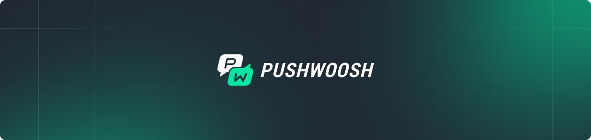

<p align="center">
  
</p>

<h1 align="center">.NET MAUI SDK</h1>

<p align="center">
  <a href="https://www.nuget.org/packages/Pushwoosh.DotNet"></a>
  <a href="https://github.com/Pushwoosh/pushwoosh-dotnet/releases"></a>
  
  <a href="LICENSE"></a>
</p>

<p align="center">
  Push notifications, in-app messages, message inbox and geozones for .NET MAUI applications on iOS and Android.
</p>

## Table of Contents

- [Documentation](#documentation)
- [Features](#features)
- [Requirements](#requirements)
- [Installation](#installation)
- [Quick Start](#quick-start)
  - [Android](#android)
  - [iOS](#ios)
- [API Reference](#api-reference)
  - [Push notifications](#push-notifications)
  - [Tags](#tags)
  - [Events and user identification](#events-and-user-identification)
  - [Message Inbox](#message-inbox)
  - [Local notifications](#local-notifications)
  - [Geozones](#geozones)
  - [Platform-specific](#platform-specific)
- [Samples](#samples)
- [Support](#support)
- [License](#license)

## Documentation

[Pushwoosh .NET MAUI SDK Documentation](https://docs.pushwoosh.com/platform-docs/pushwoosh-sdk/cross-platform-frameworks/net-maui)

## Features

- **Push Notifications** — register, receive and handle notifications on iOS and Android
- **Tags & Segmentation** — string, integer, incremental and list tags for targeting
- **In-App Messages** — event-triggered in-app messaging
- **User Identification** — associate devices with a user ID, merge users across devices
- **Message Inbox** — persistent message list with read/delete/action handling
- **Local Notifications** — schedule and cancel notifications on the device
- **Geozones** — location-triggered pushes via a separate package

## Requirements

| | On the device | In your project |
|---|---|---|
| .NET | — | 8.0 or newer |
| iOS | 11.0+ | `net8.0-ios11.0` or higher |
| Android | API 23+ | `net8.0-android34.0` or higher |

The two columns are different things, and mixing them up on Android breaks push **silently**. The
device row is the minimum OS your app can run on (`SupportedOSPlatformVersion`). The project row is
the target framework, and it decides which folder NuGet resolves inside the package:

```xml
<!-- plain net8.0-android and net8.0-ios both work: on the .NET 8 SDK they
     resolve to android34.0 and a current iOS platform version -->
<TargetFrameworks>net8.0-android;net8.0-ios</TargetFrameworks>
```

A project pinned to a *lower* Android platform version — `net8.0-android33.0`, say — still restores
and still builds. NuGet quietly falls back to `lib/net8.0`, which contains only the managed core
assemblies: no Android bindings, no `.aar`, and none of the package's Android dependencies. There is
no warning of any kind. The first symptom is that notifications never arrive at runtime, or
`CS0234: 'Android' does not exist in the namespace 'Pushwoosh'` if you reference a platform type. If
push does nothing on Android, check this before anything else.

**Simulators and devices: iOS 18.x, not 26.x.** MAUI 8 predates iOS 26 and does not render on it.
On an iOS 26.2 simulator the app installs, launches, the process stays alive — and the screen stays
black, with no UI at all. This is the framework, not this SDK: a bare `dotnet new maui` project with
no Pushwoosh code in it behaves exactly the same, measured side by side. The same build runs
correctly on iOS 18.6. There is nothing to work around at the SDK level, so target an iOS 18.x
simulator or device while you are on MAUI 8. Recent Xcode installs ship 26.x simulators by default,
so you may need to add one:

```bash
xcrun simctl create "ios18" \
  com.apple.CoreSimulator.SimDeviceType.iPhone-16-Pro \
  com.apple.CoreSimulator.SimRuntime.iOS-18-6
```

Android additionally needs a Firebase project. Each sample carries a
`google-services.json.example` next to where the real file belongs — copy your own
`google-services.json` from the Firebase console into that folder. The samples do not ship a working
Firebase config, so Android builds fail until you add one.

## Installation

```bash
dotnet add package Pushwoosh.DotNet
```

Geozones ship separately, add them only if you need location-triggered pushes:

```bash
dotnet add package Pushwoosh.DotNet.Geozones
```

## Quick Start

`PushManager.Init()` must be called on each platform before anything else — `PushManager.Instance`
is `null` until then, not a lazily created default.

**Init has to run before MAUI builds your app.** On both platforms that means calling it *before*
the `base.` call in the platform entry point, because that call is what constructs your `App` — and
anything your `App` constructor touches (event subscriptions, a page it creates, an eagerly resolved
service) would otherwise see a `null` `Instance`. On Android the entry point is `MainApplication`,
**not** `MainActivity`: Android always finishes `Application.OnCreate` before it creates any
activity, so an activity is already too late.

### Android

Declare the Pushwoosh Application Code, then initialize in `MainApplication`. The FCM sender id
does not need declaring — the SDK takes it from your `google-services.json`:

```csharp
using Android.App;
using Android.Runtime;
using Pushwoosh.Android;

[assembly: MetaData("com.pushwoosh.appid", Value = "XXXXX-XXXXX")]

[Application]
public class MainApplication : MauiApplication
{
    public MainApplication(IntPtr handle, JniHandleOwnership ownership)
        : base(handle, ownership)
    {
    }

    public override void OnCreate()
    {
        // base.OnCreate() builds the MAUI app and constructs App, which may already
        // need PushManager.Instance — so initialize first.
        PushManager.Init();
        base.OnCreate();
    }

    protected override MauiApp CreateMauiApp() => MauiProgram.CreateMauiApp();
}
```

### iOS

Set `Pushwoosh_APPID` in `Info.plist`, enable the Push Notifications capability, then initialize in
`AppDelegate` and forward the remote-notification callbacks — the SDK does not swizzle the app
delegate:

```csharp
using Foundation;
using UIKit;
using Pushwoosh.iOS;

[Register("AppDelegate")]
public class AppDelegate : MauiUIApplicationDelegate
{
    public override bool FinishedLaunching(UIApplication application, NSDictionary launchOptions)
    {
        PushManager.Init();
        return base.FinishedLaunching(application, launchOptions);
    }

    [Export("application:didReceiveRemoteNotification:fetchCompletionHandler:")]
    public void DidReceiveRemoteNotification(UIApplication application, NSDictionary userInfo,
                                             Action<UIBackgroundFetchResult> completionHandler)
        => PushManager.Instance.ReceivedRemoteNotification(userInfo);

    [Export("application:didRegisterForRemoteNotificationsWithDeviceToken:")]
    public void RegisteredForRemoteNotifications(UIApplication application, NSData deviceToken)
        => PushManager.Instance.RegisteredForRemoteNotifications(deviceToken);

    [Export("application:didFailToRegisterForRemoteNotificationsWithError:")]
    public void FailedToRegisterForRemoteNotifications(UIApplication application, NSError error)
        => PushManager.Instance.FailedToRegisterForRemoteNotifications(error);

    protected override MauiApp CreateMauiApp() => MauiProgram.CreateMauiApp();
}
```

## API Reference

Everything below lives in `PushwooshSDK.DotNet.Core` and is reached through
`PushManager.Instance`, so shared MAUI code never references a platform type.

### Push notifications

```csharp
using PushwooshSDK.DotNet.Core;

PushManager.Instance.Register();      // ask for permission and register
PushManager.Instance.Unregister();

PushManager.Instance.PushReceived += (s, e) =>
    Console.WriteLine($"{e.Notification.Title}: {e.Notification.Message}");

PushManager.Instance.PushAccepted += (s, e) =>
    Console.WriteLine(e.Notification.CustomData);   // user tapped the notification

PushManager.Instance.Registered   += (s, e) => Console.WriteLine(PushManager.Instance.PushToken);
PushManager.Instance.RegisterError += (s, error) => Console.WriteLine(error.Description);
```

| Member | Description |
|---|---|
| `Register()` / `Unregister()` | register or unregister for push notifications |
| `PushReceived` / `PushAccepted` | notification arrived / was tapped; args carry `Notification` and `FromBackground` |
| `Registered` / `RegisterError` | registration outcome |
| `AppCode` | Pushwoosh Application Code, can be set from code |
| `HardwareId` | device identifier used in all Pushwoosh API calls |
| `PushToken` | current push token, `null` until registered |
| `Language` | override the device language, lowercase ISO-639-1 |
| `ShowPushNotificationAlerts` | show an alert for pushes received in the foreground |
| `NotificationSettings` | whether notifications are enabled |

### Tags

```csharp
var tags = new TagsBundle();
tags.PutString("Name", "John");
tags.PutInteger("Age", 30);
tags.PutIncrementInteger("Visits", 1);
tags.PutList("Favourites", new[] { "books", "music" });

await PushManager.Instance.SendTagsAsync(tags);

var result = await PushManager.Instance.LoadTagsAsync();
if (result.Error == null)
    Console.WriteLine(result.Result.GetString("Name"));
```

`TagsBundle` also exposes `PutAll`, `GetInt`, `GetList` and `ToDictionary`.

### Events and user identification

```csharp
PushManager.Instance.InAppManager.SetUserId("user-42");

await PushManager.Instance.InAppManager.PostEventAsync("purchase",
    new Dictionary<string, string> { ["sku"] = "premium" });

await PushManager.Instance.InAppManager.MergeUserId("old-id", "new-id", doMerge: true);
```

Posting an event is what triggers an in-app message configured in the Pushwoosh Control Panel.

### Message Inbox

```csharp
var inbox = PushManager.Instance.InboxManager;

inbox.LoadMessages((messages, error) =>
{
    foreach (var m in messages)
        Console.WriteLine($"{m.Title} read={m.IsRead} sent={m.SendDate}");
});

inbox.UnreadMessagesCount((count, error) => Console.WriteLine(count));

inbox.ReadMessage(code);        // also ReadMessages(List<string>)
inbox.PerformAction(code);      // open the message action
inbox.DeleteMessage(code);      // also DeleteMessages(List<string>)
```

`InboxMessage` carries `Message`, `Title`, `Type`, `ActionParams`, `AttachmentUrl`, `ImageUrl`,
`Code`, `SendDate`, `IsActionPerformed` and `IsRead`. Counts are also available through
`MessagesCount` and `MessagesWithNoActionPerformedCount`.

### Local notifications

```csharp
int id = PushManager.Instance.ScheduleLocalNotification("See you soon", delay: 60);
PushManager.Instance.CancelLocalNotification(id);
PushManager.Instance.CancelAllLocalNotifications();
```

### In-app messages

HTML and rich-media in-apps are shown by the SDK with no extra setup.

**Native (template) in-apps are not rendered on .NET.** The module that draws them,
`pushwoosh-inapp-ui`, is not part of these packages, so a native in-app arrives, is recognised and
then skipped — the native SDK logs `native in-app detected but pushwoosh-inapp-ui module is not
connected, skipping` and nothing appears on screen. If your campaign uses native in-apps, build them
as HTML or rich media until the module ships.

### Geozones

Requires the `Pushwoosh.DotNet.Geozones` package and location permission granted by the app.
Initialize per platform, then drive it from shared code:

```csharp
// Platforms/Android/MainApplication.cs — in OnCreate, after PushManager.Init(),
// still before base.OnCreate()
PushwooshSDK.DotNet.Geozones.Android.LocationManager.Init();

// Platforms/iOS/AppDelegate.cs — in FinishedLaunching, after PushManager.Init(),
// still before base.FinishedLaunching()
PushwooshSDK.DotNet.Geozones.iOS.LocationManager.Init();

// shared code
using PushwooshSDK.DotNet.Geozones;

LocationManager.Instance.StartLocationTracking();
LocationManager.Instance.StopLocationTracking();
```

On iOS the usage descriptions are required — without them `StartLocationTracking()` returns
without starting anything and the native SDK only writes a line to the log. Add to `Info.plist`:

```xml
<key>NSLocationWhenInUseUsageDescription</key>
<string>Used to deliver notifications relevant to where you are.</string>
<key>NSLocationAlwaysAndWhenInUseUsageDescription</key>
<string>Used to deliver notifications relevant to where you are, including in the background.</string>
```

For background geozones also enable the Location updates background mode. On Android, request
`ACCESS_FINE_LOCATION` (and `ACCESS_BACKGROUND_LOCATION` for background tracking) at runtime before
calling `StartLocationTracking()`.

### Platform-specific

A few members exist on one platform only and need a cast to the platform type:

In shared code they have to sit behind the platform guard — the platform type does not exist in
the iOS compilation of a multi-targeted project, and `Instance` is null until `Init()` has run:

```csharp
#if ANDROID
// Android: show every push as a separate notification instead of replacing the previous one
var android = Pushwoosh.Android.PushManager.Instance;
if (android != null)
    android.MultiNotificationsMode = true;
#endif
```

## Samples

- [`Sample/`](Sample) — MAUI app: registration, tags, events, inbox
- [`GeozonesSample/`](GeozonesSample) — MAUI app with geozones
- [`PushwooshSDK.DotNet.iOS.Sample/`](PushwooshSDK.DotNet.iOS.Sample) — native iOS demo
- [`PushwooshSDK.DotNet.Android.Sample/`](PushwooshSDK.DotNet.Android.Sample) — native Android demo

The samples are wired to a Pushwoosh demo application — replace the Application Code and
`google-services.json` with your own before running them against your project.

## Support

- [Documentation](https://docs.pushwoosh.com)
- [Issues](https://github.com/Pushwoosh/pushwoosh-dotnet/issues)

## License

[MIT](LICENSE)
